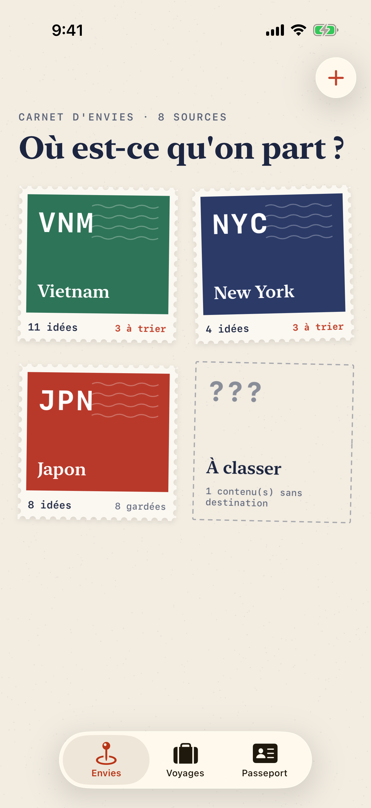
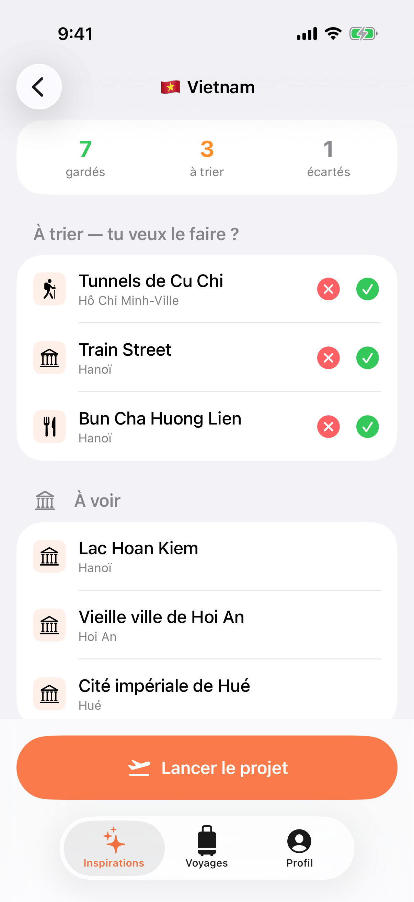
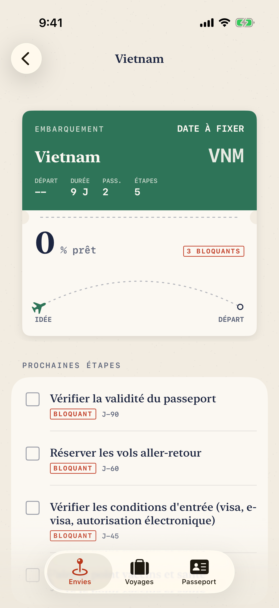
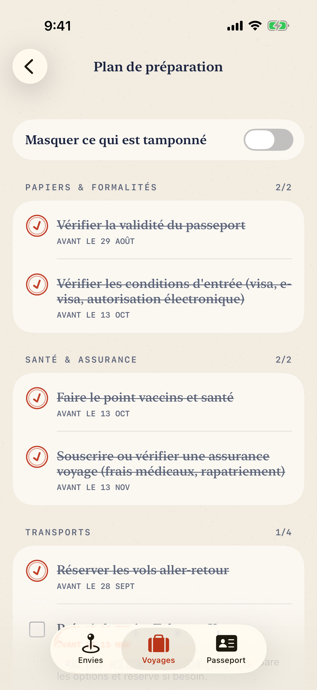
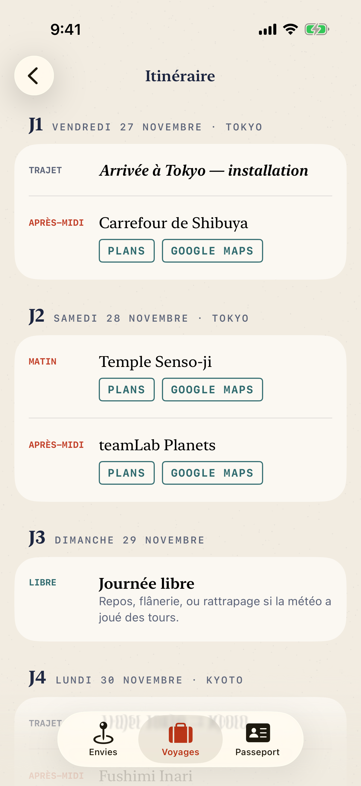
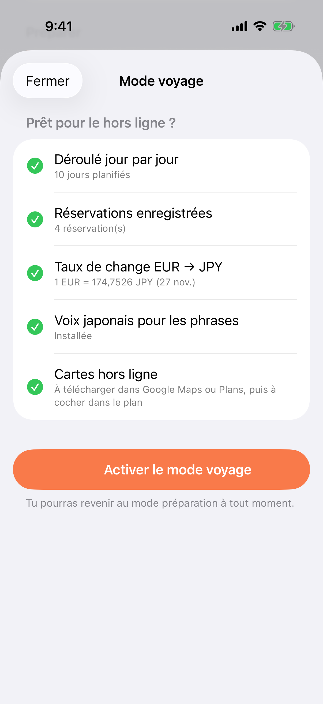
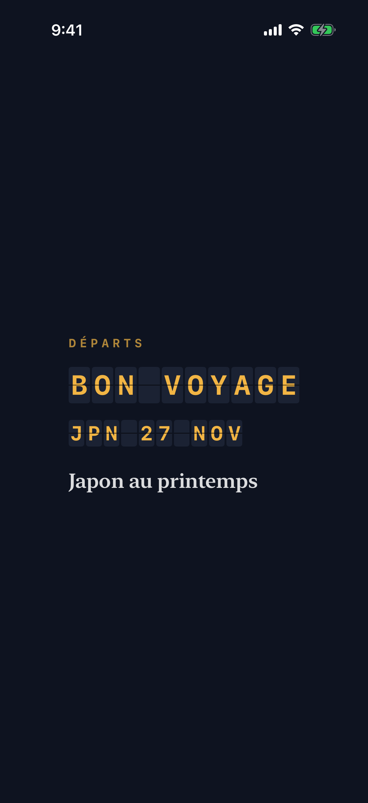
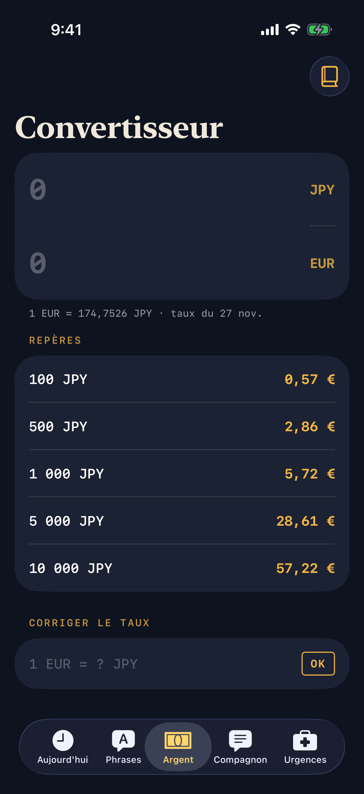

# Captures — `claude/screenshots-testflight`

Commit : 812ac5ea905691d830a829bff962af04ba6079cd

### 01-inspirations

### 02-destination

### 03-destination-suite

### 04-lancer-le-projet

### 05-tableau-de-bord-nouveau

### 06-profil

### 07-mes-voyages

### 08-tableau-de-bord-japon

### 09-plan-de-preparation

### 10-itineraire

### 11-reservations

### 12-valise

### 13-avant-le-depart

### 14-bon-voyage

### 15-mode-voyage-aujourdhui

### 16-phrases

### 17-convertisseur

### 18-compagnon

### 19-urgences

